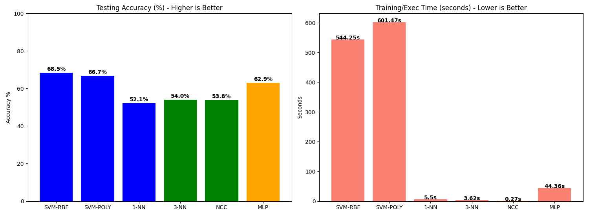

# CIFAR-10 Feature Extraction & Classification: VGG16 Transfer Learning vs. Traditional Classifiers

An empirical investigation into Transfer Learning for image classification, comparing Support Vector Machines (SVMs), Multi-Layer Perceptrons (MLPs), and Non-Parametric Baselines trained on frozen VGG16 feature representations.

---

## 📌 Project Overview

This project explores feature extraction using deep neural networks pre-trained on ImageNet. Rather than training a Convolutional Neural Network (CNN) end-to-end, a frozen VGG16 backbone is leveraged to extract 512-dimensional feature vectors per image. 

Following feature standardization and Principal Component Analysis (PCA), various classification algorithms—including SVMs (RBF & Polynomial), MLPs with Hinge Loss, k-NN, and Nearest Class Centroids (NCC)—are evaluated on speed, scalability, and classification accuracy.

---

## 📊 Benchmark Results

All models were evaluated on the complete CIFAR-10 dataset using features extracted via VGG16 and reduced via PCA (retaining 90% explained variance, ~329 components).

| Model | Hyperparameters / Details | Training / Exec Time | Testing Accuracy | Key Observations |

| :--- | :--- | :--- | :--- | :--- |

| **SVM-RBF** | C=10.0, RBF Kernel | **544.25s** | **68.50%** | **Best Accuracy.** Captures non-linear decision boundaries effectively. |

| **SVM-POLY** | C=10.0, Degree 3 | **601.47s** | **66.74%** | Strong performance, but higher compute cost without accuracy gain. |

| **MLP** | 1 Hidden Layer (128 units), Categorical Hinge Loss | **44.36s** | **62.93%** | **Best Trade-off.** ~12x faster training than SVM-RBF with competitive accuracy. |

| **3-NN** | k=3, Distance Metric | **3.62s** | **54.05%** | Low computational cost, but limited generalization. |

| **NCC** | Nearest Class Centroid | **0.27s** | **53.84%** | Extremely fast, primitive baseline. |

| **1-NN** | k=1, Distance Metric | **5.50s** | **52.11%** | Sensitive to high-dimensional noise. |

> *Note: The SVM Linear kernel was omitted from the final run as empirical sub-sampling projected a convergence time exceeding 15 hours due to non-linearly separable feature space.*

---

## 📈 Visual Performance Comparison

---

## 🔬 Critical Architectural Insights

### 1. Non-Linear Decision Boundaries

Experiments on training sub-samples revealed that CIFAR-10 features extracted by VGG16 are not linearly separable. The Linear SVM required over 55 minutes on 15,000 samples while obtaining lower accuracy than the RBF kernel.

### 2. Resolution Mismatch in Transfer Learning

* **Frozen Transfer Model (VGG16 + SVM):** Peak accuracy reached **68.5%**.

* **Custom CNN Trained from Scratch:** Achieved **~84.7%** accuracy on the same dataset.

* **Why the difference?** VGG16 was originally optimized for high-resolution ImageNet input (224 x 224). Passing small 32 x 32 CIFAR-10 images through a frozen network leads to spatial detail loss in earlier pooling layers. Fine-tuning or end-to-end custom architectures yield superior performance for low-resolution tasks.

---

## 🛠️ Pipeline Architecture

Input Images (32x32x3)

  │

  ├── Keras preprocess_input (RGB -> BGR, Zero-Centering)

  ├── VGG16 Feature Extraction (Frozen Base, 512 Features)

  ├── StandardScaler (Mean=0, Variance=1)

  ├── PCA (90% Variance Retained (~329 Components))

  │

  └── Classifier Evaluation (SVM-RBF, SVM-POLY, MLP, k-NN, NCC)

---

## 🚀 Setup & Execution

### Prerequisites

* Python 3.11+

### Execution

1. Clone the repository:

   git clone https://github.com/ChrysKoubanis/vgg16-transfer-learning-cifar10.git

   cd vgg16-transfer-learning-cifar10

2. Create and activate a virtual environment:

   Windows:
      python -m venv venv
      .\venv\Scripts\activate

3. Install required dependencies:

   pip install -r requirements.txt

4. Run the main evaluation script:

   python main.py